<picture>
  <source media="(prefers-color-scheme: dark)" srcset="../../assets/hero-dark.svg">
  
</picture>

# Sage Relay

[](https://github.com/byShrey/sage-relay/actions/workflows/test.yml)  

A plugin for Claude Code that hands a long chat to a fresh one before it gets slow and expensive, and keeps the thread.

Other handoff tools wait for you to type `/handoff`. This one watches the meter and does it on its own, mid-task if it has to.

## Why bother

Every message you send carries the whole chat with it. In a 300k-token chat, typing "thanks" costs 300k tokens. Long chats also get slower and start forgetting the middle.

Sage Relay writes down what happened, clears the chat, and hands the note to a new chat that picks up where the old one stopped.

## How it works

1. Sage Relay watches the chat's size and gives you one heads-up at 250k.
2. At 300k it stops new tool calls. A small local Python script writes the whole conversation into a note: every message, minus tool output, with secrets blanked out. No AI call, no network.
3. The chat clears and the note arrives as the first message. The new chat shows where the work stopped, word for word, then waits for you or carries on.

## See it work

<picture>
  <source media="(prefers-color-scheme: dark)" srcset="../../assets/demo-dark.svg">
  
</picture>

The messages in the replay are the plugin's real ones. The fresh chat's 82k is from a real handoff; yours depends on how long the chat was.

## Install

```bash
claude plugin marketplace add byShrey/sage-relay
claude plugin install sage-relay@sage-relay
```

Restart the app. You need `python3` (3.9 or newer) on macOS or Linux. On a Mac without the developer tools, install those first. If Python can't run, handoff switches itself off with one notice. It never clears a chat it couldn't save.

## What it does, and when

| When | What happens |
|---|---|
| The chat reaches 250k (83% of the handoff point) | One notice, saying where the handoff will happen. |
| The chat reaches 300k, or 80% of the model's window if that is smaller | Builds the note, clears the chat, sends the note to the new chat. Anything you type meanwhile is held and goes along with the note. |
| You come back after 55+ minutes to a chat of 80k or more that has grown at least 20k since it began | The saved copy of the chat has probably expired, so your next message would re-pay all of it. Sage Relay hands off instead, and your message rides along with the note. |
| Same, but the chat is 50k to 80k (still 20k past its start) | Your message is held once, with the cost. Send it again within 2 minutes to go ahead anyway. |
| You hit 95% of your 5-hour usage limit | One notice. Nothing is cleared. |
| A fresh chat after a handoff | It waits for 40k tokens of growth before it can hand off again, and stops at 2 in a row until you type. |

If the note fails, the chat is **kept** and you see "note failed, chat kept". If the note can't reach the new chat, it goes along with your next message instead, or `/switch resend` sends it.

## Commands

```
/switch status          size, handoff point, flags, last note, version
/switch note            build the note and preview it, without clearing
/switch handoff         hand off now
/switch handoff off|on  stop or start automatic handoff for this chat
/switch resend          send the last note again
/switch ceiling 200000  move the handoff point (minimum 20000)
/switch routing on|off  pick a model for helpers by type (off by default)
/switch opus high       fix a model for this chat (also: sonnet low|medium|high)
/switch off             routing off, no fixed model
/switch log             last 10 routing log lines
```

## Settings

Plain files, one value each, in `~/.claude/sage-relay/`:

- `ceiling`: the handoff point in tokens (minimum 20000). The newest of this file and `/switch ceiling` wins. Delete it to go back to 300k.
- `sonnet-default`: put `on` to start every chat on Sonnet 5.5 medium and send hard thinking to an Opus helper. Off unless you add it.
- `pin-models`: put `on` to start with helper routing on.

Notes live in `~/.claude/sage-relay/notes`, readable only by you, and are deleted after 14 days.

## The second job: helpers

Three helper types come with the plugin. The chat picks one when the work calls for it:

- **Deep** (Opus, high effort): planning, design, research, audits.
- **Careful** (Sonnet, high effort): clear multi-step work like tests or a one-file refactor.
- **Scout** (Sonnet, read-only): finding and reading.

Easy questions stay in your chat. Helpers start without your chat's history, so the chat has to give them a full brief. Their descriptions add about 400 tokens to every chat.

## FAQ

**Why not just use `/compact`?**
Compaction writes a short summary. Sage Relay keeps what was said. In a blind 30-question test on one real chat, the Sage Relay note scored 28.5/30 and built-in compaction scored 15.5/30. That was one chat and one run, so read it as a hint.

**Does it send my chat anywhere?**
The plugin makes no network calls and no AI calls. The note is written to your own disk. The new chat then sends it to the API like any message you type.

**Will it cut me off mid-task?**
At the line it refuses new tool calls, lets the reply in progress end, then hands off. If it had to stop work mid-task, the new chat carries straight on. Otherwise the new chat shows where things stopped and waits for you.

**Windows?**
Not tested. The file lock works differently there.

## Choosing a handoff point

A replay of 9 days of one person's real chats (5,849 replies from one user):

| Handoff point | Handoffs per day | Cost vs 300k |
|---|---|---|
| 200k | 8.6 | about 20% lower |
| 300k | 3.9 | the default |
| 400k | 2.4 | about 13% higher |
| 500k | 1.6 | about 26% higher |

The replay can't measure what each handoff loses, so lower isn't automatically better.

## What was tested, and what wasn't

- 18 hook tests, 44 handoff scenarios on a fake engine (one for each bug ever fixed), and 36 tests for the note builder, including a secret-filter list of 38 key formats and a speed test on hostile input. All of it runs on every push.
- Two outside audits per release by a different AI family, every finding checked against the code.
- A real handoff on 0.7.0: the fresh chat opened at 82k tokens, against 190k with 0.6.1.
- **Not tested live yet:** the idle auto-handoff on the real app (proven on the fake engine only), routing switching on at plan approval, how often the chat picks the right helper, Windows.
- Very long chats have their middle trimmed to fit a size cap, so for those the note is not word for word.

## Privacy and security

The note holds your conversation minus tool output. Secrets are blanked out by pattern: key blocks, common token formats, `*_PASSWORD` and `*_KEY` style names, database URLs with passwords, card numbers. It's best effort, so read a note (`/switch note`) before you share one. History carried into a new chat is labelled untrusted, and lines that look like rules are listed for you to confirm, not obeyed.

Found a hole? See [SECURITY.md](../../SECURITY.md).

## Licence

MIT, see [LICENSE](../../LICENSE).

<details>
<summary>Do not open</summary>

```
      o            o
    _/|\_[=] ->  _/|\_
      / \          / \
 ----------------------------
  you made it to the finish line.
  type /switch baton in any chat.
```

</details>
